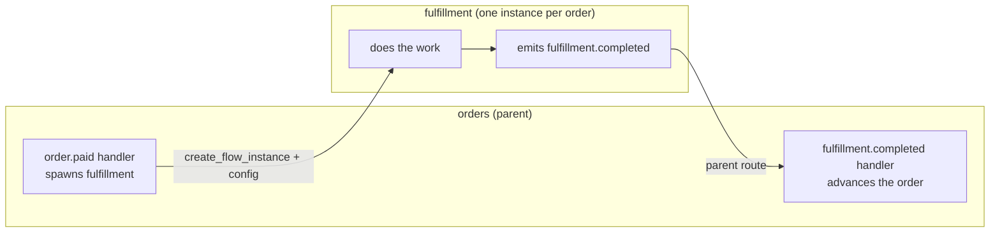

A larger system is built by nesting flows: a parent declares child flows, and the engine walks
the tree into one connected runtime. Flows connect *only* through **pins**, the typed events and
fields at their edges, so a child can be reused or swapped without touching the parent's
internals.

Beyond declaring children, composition is mostly the **round trip**: getting work into a child
and getting a result back out to the right place.

This page works one example end to end. The parent is an `orders` flow; it has a `notify`
child (one instance, wired at boot) and a `fulfillment` child (one instance per order, created
at runtime).



## Why crossing a boundary needs an address

Inside a flow, an event just goes to its subscribers. Across a boundary it is not that simple,
and the reason is multiplicity: **a flow is not a single recipient.** A template flow can have
thousands of live instances (one per order, each owning its one entity). So "send
`fulfillment.completed` to the orders flow" is ambiguous: *which* order's instance?

Every cross-flow hop therefore has to answer one question — **which instance** the event is
for; the instance's entity comes with it. The `connect` edge, the parent route, and a receiver-side `select_entity` are
just different ways to answer it. That question is the whole reason wiring across flows takes more
than a subscription, and it is worth keeping in mind as you read the rest of this page.

## Declare the children

A parent lists its children in `package.yaml`, each with a mode:

```yaml orders/package.yaml
flows:
  - id: notify
    flow: notify
    mode: static        # exactly one instance, created at boot
  - id: fulfillment
    flow: fulfillment
    mode: template       # zero at boot; one instance per order, created at runtime
```

Each child lives under `flows/{child}/` with its own full package. Which mode to use is the
first design decision:

| | Static child | Template child |
|---|---|---|
| Instances | one, at boot | one per work item, at runtime |
| Entities | its one shared entity (or stateless) | one entity per instance |
| Reached by | a `connect` edge | a `connect` edge + the pin's `resolution` (which can mint the instance) |
| Use for | a shared service (notifications, audit) | per-order, per-customer work |

## Declare the pins

Pins are a flow's public interface, declared in its `schema.yaml`. An event a flow accepts from
outside is an **input event pin**; an event it sends outward is an **output event pin**. Entity
fields it exposes are **data pins** (`reads` and `writes`). Everything not listed is private.

```yaml notify/schema.yaml
pins:
  inputs:
    events: [order.shipped]      # notify accepts this from the parent
```

```yaml fulfillment/schema.yaml
pins:
  outputs:
    events: [fulfillment.completed]   # fulfillment sends this back out
```

```yaml orders/schema.yaml
pins:
  outputs:
    events: [order.shipped]            # orders emits this to notify
  inputs:
    events: [fulfillment.completed]    # orders accepts the result back
```

A producer's output pin and a consumer's input pin are two halves of one connection: both must
declare the event, or the wire does not exist.

## Pattern 1: the `connect` block — every edge declared

Cross-flow delivery has exactly one mechanism: the package root's **`connect:` block** binds
output pins to input pins, edge by edge. Pin addresses are `<flow-id>.<pin-name>`; the root
flow's own pins use a leading dot (`.pin-name`):

```yaml package.yaml
name: jobs
version: 1.0.0
platform_version: ">=0.7.0 <0.8.0"
flows:
  - id: worker
    flow: worker
    mode: template
connect:
  - from: .job_requested        # root output pin →
    to: worker.job_requested    #   child input pin
  - from: worker.job_done       # child output pin →
    to: .job_done               #   back to the root
```

Every cross-flow delivery comes from this graph and nowhere else. `swarm verify` checks each
edge at boot, so a broken wire is an error you see immediately rather than an event that
quietly goes nowhere:

- a `from` with no producer
- a `to` with no pin
- an event mismatch across an edge
- an output pin bound nowhere

Subscriptions never cross a flow boundary: inside a flow, subscriptions; between flows,
edges.

Once an edge exists, the producer just emits: the event leaves through its output pin, the
edge carries it, and the *receiving* pin's `resolution` + `carries` decide which instance
handles it (next pattern).

## Pattern 2: spawn a template instance

<Note>
  Two ways to get an instance: mint it explicitly with `create_flow_instance` (below), or let
  the receiving pin mint it on first event — often simpler; see *Addressing an existing
  instance*.
</Note>

A template child does not exist until you create one. A handler mints an instance with the
`create_flow_instance` action, passing data in through `config_from` (there is no shared memory
between flows; data crosses through the payload or config, never through direct entity reads):

```yaml orders/nodes.yaml
order.paid:
  action: create_flow_instance
  template: fulfillment
  instance_id_from: payload.order_id       # the new instance's id
  config_from:
    order_id: payload.order_id             # values the child reads as config
    address: payload.ship_to
  advances_to: fulfilling
```

What `create_flow_instance` does:

- validates the template and builds the instance path
- registers the instance's nodes and agents
- records a **parent route** — a standing return address so the child's output events come
  back here
- creates the child's entity at its `initial_state` and starts it

A child can declare `auto_emit_on_create` in its schema to fire its first event
from that config.

`instance_id_from` must resolve to an id that is unique per instance you intend to create.
Creating an instance whose id already exists fails closed (the handler errors rather than reusing
or overwriting the live instance), so derive the id from a stable business key like the order id.

**Addressing an existing instance.** The *receiver* owns instance selection, not the emitting
handler. The child's input pin declares how an arriving event finds its instance — by the
identity field the pin carries:

```yaml fulfillment/schema.yaml
mode: template
instance: order_id                 # one instance per order_id
pins:
  inputs:
    events:
      - name: expedite
        event: fulfillment.expedite
        resolution:
          mode: select             # must match an existing instance; select-or-create would mint
        carries:
          order_id: {from: payload.order_id, type: text}
```

The parent just emits `fulfillment.expedite` through its output pin and the `connect` edge; the
carried `order_id` does the addressing.

## The return path

The child has its own state and its own entity; when it finishes, it sends a result back as an
**output pin** event:

```yaml fulfillment/nodes.yaml
fulfillment.packed:
  advances_to: done
  emit:
    event: fulfillment.completed      # an output pin
    fields:
      order_id: entity.order_id       # carry the key the parent needs
      tracking: entity.tracking
```

Because the instance was created with a parent route, that output pin returns to the parent
automatically — the producer never targets anything. (Request/reply correlation, when you need
it, is declared on the *receiving* pin, not chosen per-emit.)

The parent receives it on a handler, and here is the key move: the parent must **re-attach to
the right order**, because the event arrived at the `orders` flow, which holds many orders, not
at a specific one. It does that with `select_entity`, using the key the child carried in the
payload:

```yaml orders/nodes.yaml
fulfillment.completed:
  select_entity:
    by:
      order_id: payload.order_id      # find the order this result belongs to
  data_accumulation:
    writes: [tracking]
    source_event: fulfillment.completed
  advances_to: shipped
```

So the full loop is: parent spawns the child with `create_flow_instance` and `config_from`; the
child works in its own state machine; the child emits an output pin carrying the business key;
the parent route delivers it back; the parent re-selects its entity by that key and continues.

## Ownership rules to keep straight

- **Each flow owns its own entity.** A receiving handler must say how it acquires one:
  `create_entity`, `select_entity`, or `select_or_create_entity`. State is flow-local; nothing
  reads another flow's entity directly.
- **Data crosses only through payloads and `config_from`.** Cross-flow entity reads are
  prohibited; carry what the other side needs in the event.
- **One writer per data pin.** Two flows may not both write the same entity field (a boot error).

## Addressing reference

When you name an event or flow, it resolves by whether it contains a slash:

- **Local**: `order.paid`, an event in the current flow.
- **Absolute**: `intake/ticket.ready`, navigated from the root.
- **Wildcard**: `fulfillment/*/fulfillment.completed` matches any direct instance; `**` matches
  any depth. Wildcards expand to include new dynamic instances as they are created, which is how
  a parent subscribes to results from instances that did not exist at boot.

## Policy inheritance

Child flows inherit parent and root policy and override specific keys. See
[Policy](/build/policy).

<Note>
  **Retired spellings.** Older bundles may contain these; all fail at load or verify:
  scoped subscriptions (`validation/mailbox.review_requested`) and cross-flow wildcards,
  which fail verify with `legacy_qualified_subscription`; producer-side
  `target: { instance_id }` / `target: { flow, match }`; and `target: sender` for
  request/reply.
</Note>

<CardGroup cols={2}>
  <Card title="Events and routing" icon="bolt" href="/concepts/events-and-routing">
    The full routing model: targets, the parent route, wildcards, and the event envelope.
  </Card>
  <Card title="Flows and entities" icon="diagram-project" href="/concepts/flows-and-entities">
    Flows, instances, entities, and pins as a public interface.
  </Card>
</CardGroup>
