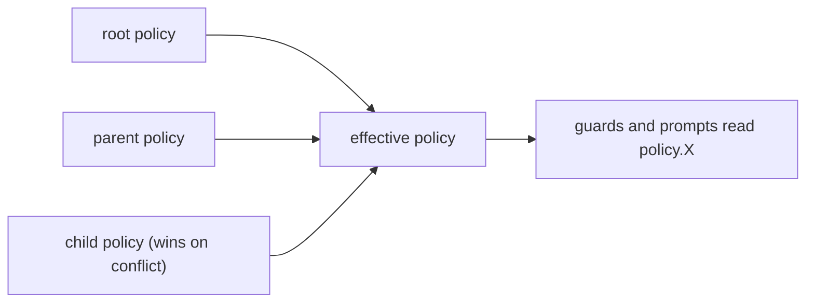

`policy.yaml` holds named configuration values for a flow. They are referenced in CEL as
`policy.*` and in prompts as `{{variable}}`.

```yaml policy.yaml
sla_hours: 24
max_escalations: 3
```

```yaml
# in a guard
check: "entity.escalation_count < policy.max_escalations"
```

## Inheritance

Policy is hierarchical. A child flow inherits the root and parent policy, and overrides
specific keys:

```yaml
# parent policy.yaml
timeout_hours: 24
max_retries: 3

# child policy.yaml
timeout_hours: 48    # overrides the parent; max_retries stays 3
```

Guards and prompt templates resolve a key by walking child → parent → root.



## Budget thresholds

Cost control is configured here. When token spend crosses a declared percentage the platform
emits `platform.budget_threshold_crossed` with a matching `level`:

```yaml
budget_warning_percent: 60
budget_throttle_percent: 80
budget_emergency_percent: 95
```

If these keys are absent, budget monitoring is disabled. An emergency raises a mailbox item
for a human. See [Budget and cost](/operate/budget-and-cost).

## Policy-sheet rows: business rules as typed tables

A handler can carry a list of `rules:`. Some rules decide *which branch runs*; others just
*compute a value* the branch will use — by looking something up in a table, running a
validation, or calling a compute module. Those tables and validations are declared here in
policy. Condition rules (`when:`/`case:`/`range:`/`else:`) select the branch; **value rows**
derive their values in the compute phase, before the handler decides what to do. The value
rows come in three kinds:

**Lookup rows** match an input tuple against an inline finite table:

```yaml nodes.yaml
ticket.classified:
  rules:
    - id: pick_queue
      lookup:
        on: [payload.category, payload.priority]
        entries:
          - {key: [billing, high],  value: senior-billing}
          - {key: [billing, low],   value: billing}
          - {key: [technical, high], value: oncall}
        into: computed.queue
        default: fail             # a miss fails the handler with an error naming this row and the values it looked up
```

A later rule reads `computed.queue` to pick the branch.

**Validation rows** run a named validation set (declared under `validation:` in
`policy.yaml`) and bind a typed result:

```yaml
- id: validate_manifest
  validate:
    set: deploy_manifest
    input: {source_ref: payload.source_ref}
    into: computed.validation.deploy_manifest
- id: invalid_manifest
  when: computed.validation.deploy_manifest.valid == false
  emit: deploy.manifest_invalid
```

**Compute-module rows** run sandboxed algorithmic logic
([Compute modules](/build/compute-modules)).

The constraints on value rows:

- Value rows derive only — they cannot emit, advance, or write state.
- A condition rule consumes their `computed.*` binding and owns the branch.
- One rule declares exactly one row type.
- `computed.*` lives only for the handler — persist a value explicitly with
  `data_accumulation`.

## Other policy-owned settings

`policy.yaml` is also where these are declared:

| Setting | What it is |
|---|---|
| `criteria` | Agent judgment rule sets. |
| `validation` | Validation sets used by validate rows. |
| `modules` | [Compute modules](/build/compute-modules). |
| `mcp_servers` | MCP server registrations ([Tools](/build/tools)). |
| `workspace_classes` | The `/workspace` scope per agent class. |
| `permission_bundles` | Named permission sets. |
