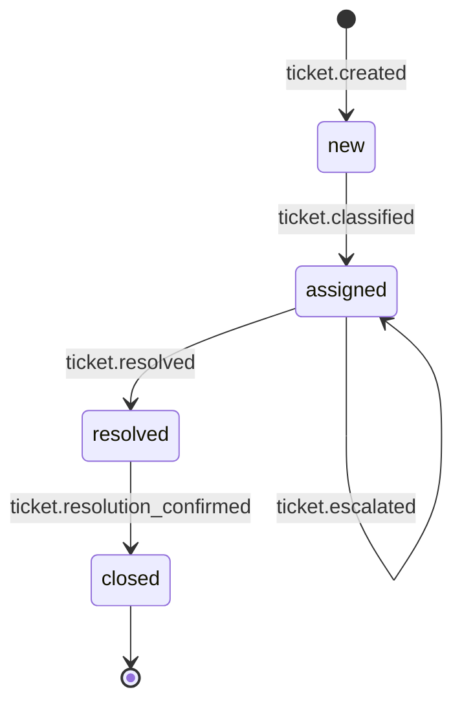

A flow's **state machine** is the lifecycle of the entity moving through it. The entity sits
in exactly one stage at a time, and a handler moves it forward by setting `advances_to`.
`schema.yaml` declares that lifecycle, along with the flow's public **pins** and the **agent
roles** it needs.

The support-ticket flow has this lifecycle:



Each arrow is a handler's `advances_to`, and the label is the event that triggers it. The
self-arrow on `assigned` is the escalation retry loop.

## Stages

```yaml
stages:
  new:
    initial: true
  assigned: {}
  resolved: {}
  closed:
    terminal: true
```

An entity is in exactly one stage, set by a handler's `advances_to`. Terminal stages are
absorbing: once reached, new events are rejected and timers are cancelled. A flow that
declares no `stages:` is stateless. Stages are also where **stage timers** attach — a
`timers:` block on a stage can advance or escalate an entity that has sat too long; see
[Gates, timers, and state](/concepts/gates-timers-and-state).

Every declared stage must be reachable: it is either the initial stage or the target of some
`advances_to` (including a stage timer's). The analyzer flags stages that nothing reaches
(see [Analyzer checks](/reference/analyzer-checks)).

<Note>
  The older list grammar (`initial_state` / `terminal_states` / `states:`) still parses, but
  `stages:` is the canonical form — new features (stage timers, join stages) attach to it.
  New flows should use `stages:`.
</Note>

## Pins

Pins are the flow's public interface. Event pins declare what it accepts and emits; data pins
declare what entity fields it reads and writes.

```yaml
pins:
  inputs:
    events: [ticket.created]
    reads: [priority]
  outputs:
    events: [ticket.resolved, ticket.abandoned]
    writes: [category, resolution]
```

No two flows may write the same data pin, that conflict is a boot error. Output event pins
are the flow's exit points for cross-flow routing: the parent package binds them with
`connect` edges, and the *receiving* flow's input pin owns instance selection through its
`resolution` and `carries` declarations. The producer never chooses recipients — an emit
carries no routing authority (see [Emitting events](/build/handlers/emitting)). Internal
events not listed in pins are ordinary event-loop emits delivered by subscription.

## Required agents

`required_agents` is **optional**: when omitted, the flow's effective required-agent facts
are derived from `agents.yaml`. Declare it when the flow is an interface boundary — a package
someone else fulfills with their own agents — because an authored list (including an explicit
empty one) turns inference off and becomes the contract. Fulfillment has two conditions, both
checked at boot:

```yaml
required_agents:
  - role: classifier-agent
    subscribes_to: [ticket.created]
    emits: [ticket.classified]
```

1. An agent in `agents.yaml` whose map key matches the `role` name.
2. That agent's subscriptions cover the required `subscribes_to`, and its `emit_events` cover
   the required `emits`.

## Acquiring an entity

A stateful flow's input-pin handler must say how it gets the entity to operate on. It
declares exactly one acquisition mode:

- `create_entity: true`: mint a new entity at the initial stage.
- `select_entity`: resolve exactly one existing flow-owned entity by a declared business
  key.
- `select_or_create_entity`: resolve one existing, or deterministically mint one.

Omitting all three on a stateful input-pin handler is a boot error. See
[Composing flows](/build/composition) for cross-flow handoff patterns.
