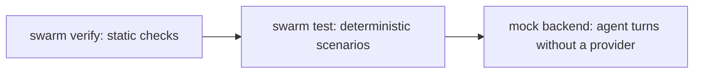

Swarm gives you three layers of testing, cheapest to most thorough — and none of them needs
an LLM credential:



## The static analyzer

`swarm verify` validates a contract bundle against the platform specification — the one
command that runs purely on files, with no runtime needed.

```bash
swarm verify --contracts ./ticket-flow
```

The same checks run at boot. Findings have a severity: an `error` aborts (the bundle cannot
ship), a `warning` is logged but allows boot. Checks cover payload coverage, stage
reachability, agent fulfillment, handler-field validity, entity write targets, CEL parsing,
single-node-per-event, and event cycles, among others. See
[Analyzer checks](/reference/analyzer-checks) for the catalog.

## Scenario tests: `swarm test`

A **scenario** is a YAML file that publishes events into your real flow and asserts what came
out — events, entity state, gates — through the public API, against a real runtime. Scenarios
live with the contracts they prove:

- `contracts/tests/…` — package-wide, cross-flow scenarios
- `contracts/flows/<flow>/tests/…` — flow-local scenarios (these ship with a published flow,
  so consumers can run your tests against their own agents and wiring, and see whether their
  version still behaves the way yours does)

```yaml contracts/tests/classify-and-assign.yaml
name: billing ticket is classified and assigned
vars:
  ticket_id: "${scenario.uuid('t1')}"   # deterministic — derived, never random
steps:
  - publish: ticket.created
    payload:
      ticket_id: "${vars.ticket_id}"
      subject: "double charge"
  - publish: ticket.classified
    payload:
      from: fixtures/classified.yaml    # load a fixture file…
      set:
        ticket_id: "${vars.ticket_id}"  # …and override fields
expect:
  events:                               # unordered include-match by default
    - ticket.assigned
  entities:
    - type: ticket
      current_state: assigned
      fields:
        category: billing
```

The rules that keep scenarios deterministic and honest:

- **Plain YAML is literal; `${...}` is CEL.** No other expression grammar.
- **Helpers are deterministic**: `scenario.uuid(label)` derives from the scenario's identity
  and recorded seed — never wall-clock, never random. Reruns are byte-identical.
- **Payloads are schema-validated before publish** — a fixture that doesn't match the event
  schema fails the scenario before anything mutates.
- **The runner only speaks the public API** (`event.publish`, `entity.get`, run readback). It
  cannot reach behind the API into the database or the event bus — a scenario proves what a
  real client could observe, nothing more.
- **`expect` runs at quiescence** — after the run settles, not on a sleep. `expect.events`
  supports `include` (default), `exact`, and `ordered` matching; entity assertions compare
  exactly against `entity.get`.
- A `setup:` block can seed deterministic entity rows (through the public setup owner) when a
  scenario needs pre-state, and an `invalid:` table asserts that malformed fixture variants
  are rejected outright rather than partly applied (fail-closed). See the scenario format for
  both.

Run them with:

```bash
swarm test --contracts ./ticket-flow            # all scenarios under the roots
swarm test contracts/tests/classify-and-assign.yaml
```

## The mock LLM backend

Scenario steps drive the deterministic side of a flow. To execute **agent turns** without a
provider credential, give agents a mock performance — a small Python module, run by the
embedded interpreter, standing in for the model:

```yaml agents.yaml
classifier-agent:
  model: regular
  subscriptions: [ticket.created]
  emit_events: [ticket.classified]
  memory: false
  mock: {kind: python, module: mocks/classifier.py}
```

The module's `handle` entrypoint receives the turn input and returns the tool calls the agent
would make (typically an `emit_*`). The platform runs it through the **real runtime** — real
subscriptions, real tool surfaces, real persistence — so what you prove is the actual event
chain, not a simulation. Guarantees worth knowing:

- The module is captured at contract compilation (path, bytes, digest) into the bundle —
  runtime never re-reads the ambient file, so a run and its replay see identical behavior.
- External writes are **fail-closed in mock mode**: a mocked agent simply cannot reach a real
  connector.
- Cost accounting shows `~$… (mock estimate)` — separated from real spend, never mixed.

Mock performances and scenarios compose: a scenario publishes the triggering event, the
mocked agent takes its turn through the real runtime, and `expect` asserts the outcome — a
full agent flow, end to end, with zero credentials and zero Docker.

## Before you deploy

<Check>Every `advances_to` target is a declared stage.</Check>
<Check>Every emitted event has a payload schema, and emit sites supply all declared fields.</Check>
<Check>Every entity field a handler writes exists in `entities.yaml`.</Check>
<Check>Every condition is prefixed (`payload.`, `entity.`, `policy.`) and references real fields.</Check>
<Check>No two system nodes handle the same event.</Check>
<Check>A handler uses either `rules:` or `on_complete:`, never both.</Check>
<Check>Each stateful input-pin handler declares one entity-acquisition mode.</Check>
<Check>`swarm verify` returns no errors, and `swarm test` passes your scenarios.</Check>
