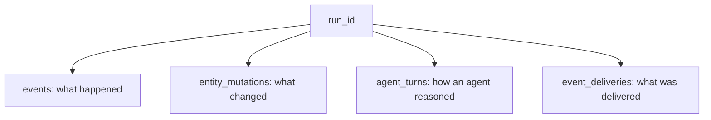

Persistence is the substrate, not an add-on. It is what makes Swarm runs auditable,
replayable, and recoverable.

## Two layers of history

The platform records history at two levels:

- **The event store (`events`)**: every event, appended before it is delivered. Answers
  *what happened*.
- **The mutation log (`entity_mutations`)**: every change to an entity field, with the
  before and after value and the event that caused it. Answers *what changed, and why*.

Every event, delivery, session, and turn is correlated by a **`run_id`** in the `runs`
table, so a run is a first-class execution context you can reconstruct end to end.

## The flight recorder

Four tables together form a step-by-step audit trail of any run:

| What happened | Where it lives |
|---|---|
| An event fired | `events` |
| An entity field changed | `entity_mutations` |
| An agent reasoned | `agent_turns` |
| An event was delivered | `event_deliveries` |

Joined on `run_id` and ordered by time, these answer "what did entity X look like when event
Y fired?" without reverse-engineering it from current state.

## Replay

Because everything is persisted, work can be re-delivered:

- **Event replay** redelivers a persisted event to its original subscribers (or a subset),
  creating a new event that records which event it came from, so the replay is visible in
  history rather than hidden.
- **Agent replay** is the same primitive scoped to one agent; **replay-backlog** redelivers
  an agent's pending events after a restart.
- **Crash recovery** replays any event that was persisted but not yet marked delivered —
  and because replaying an event produces the same result as the first delivery, nothing is
  duplicated.

## Fork

Because every field change records its before value, the runtime can wind an entity back to
any moment. Fork uses that to rebuild a run's state at a chosen point and continue from
there.

<Note>
  Run-level fork is available as [`swarm run fork`](/operate/fork-and-replay); forks
  currently run against the same contract bundle as the source run.
</Note>
